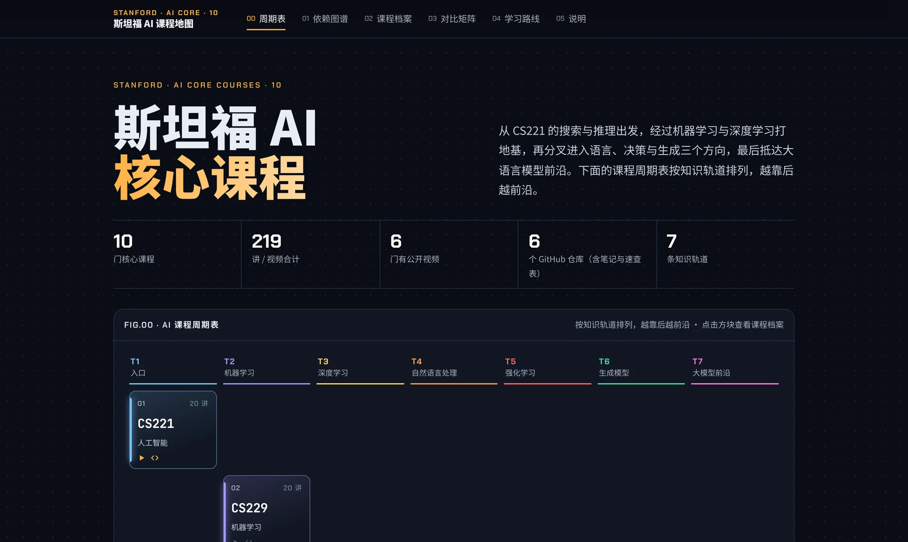
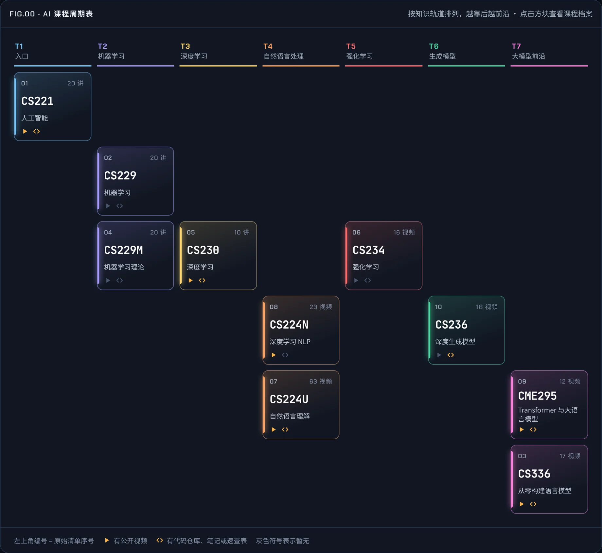
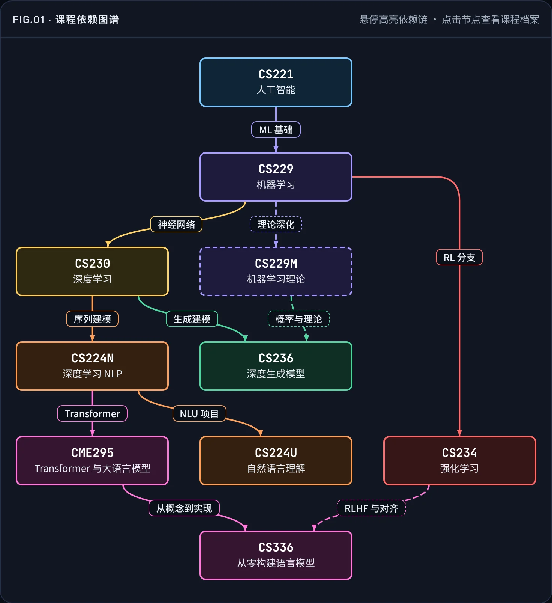
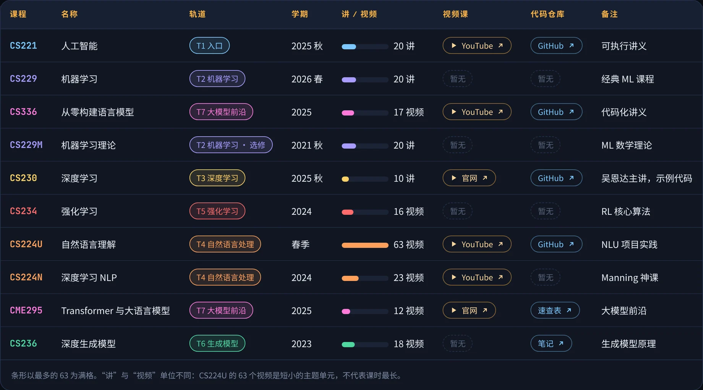
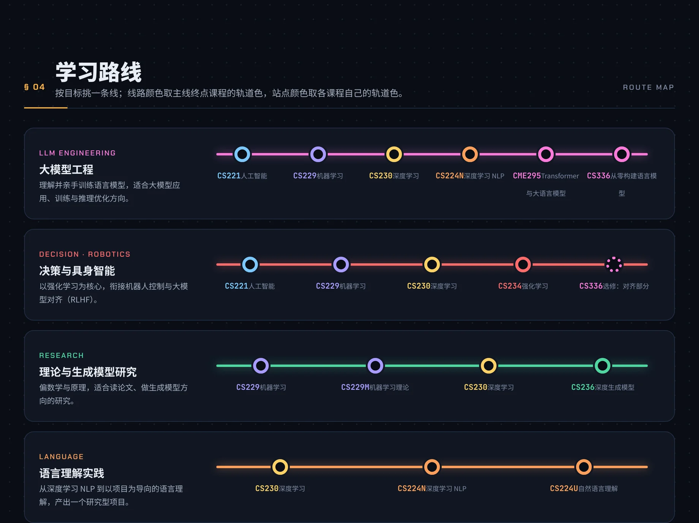
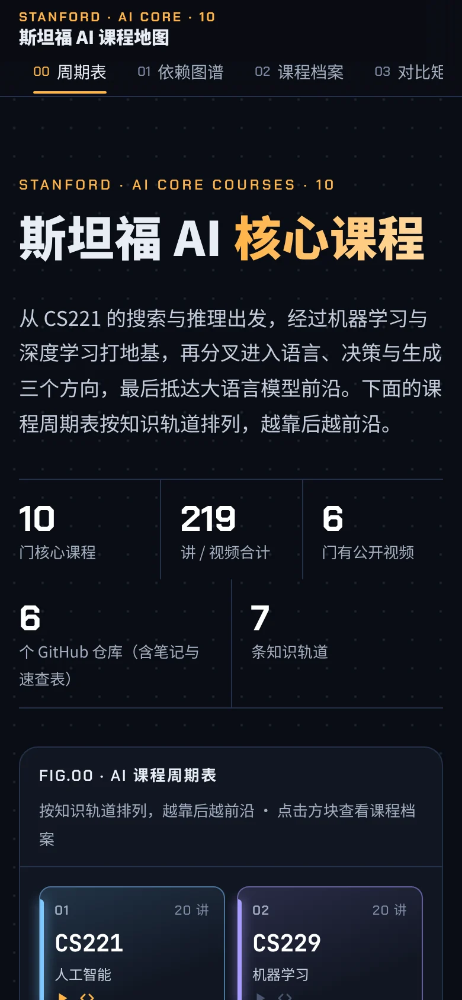

<div align="center">

<a href="https://meetrust.github.io/stanford-ai-courses/"></a>

# 斯坦福 AI 课程地图

**从 CS221 出发，经机器学习与深度学习打地基，再分叉进入语言、决策与生成三个方向，最后抵达大语言模型前沿。**

把斯坦福 10 门 AI 核心课程整理成一张可视化地图：按知识轨道排列，越靠后越前沿。

[](https://meetrust.github.io/stanford-ai-courses/) [](https://github.com/meetrust/stanford-ai-courses/actions/workflows/deploy-pages.yml)   

[在线访问](https://meetrust.github.io/stanford-ai-courses/) · [概览](#概览) · [页面内容](#页面内容) · [页面预览](#页面预览) · [设计语言](#设计语言) · [技术实现](#技术实现) · [本地预览](#本地预览)

</div>

## 概览

页面用“周期表”展示 10 门课程所在的知识轨道，用依赖图谱说明先学什么、为什么，再为每门课程建立档案：学期、讲数、公开视频与代码仓库一目了然。适合想按体系补齐 AI 基础、又不知道从哪门课开始的学习者。

| **10** | **219** | **6** | **6** | **7** |
|:---:|:---:|:---:|:---:|:---:|
| 门核心课程 | 讲 / 视频合计 | 门有公开视频 | 个 GitHub 仓库（含笔记与速查表） | 条知识轨道 |

## 页面内容

| 章节 | 内容 | 主要图表 |
|---|---|---|
| 00 周期表 | 按知识轨道排列的 10 门课程，资源一眼可见 | FIG.00 AI 课程周期表 |
| 01 课程依赖图谱 | 推荐学习顺序，每条连线说明前一门课提供了什么 | FIG.01 课程依赖图谱 |
| 02 课程档案 | 学期、讲数、公开视频与代码仓库，支持按方向和资源筛选 | — |
| 03 对比矩阵 | 10 门课程的轨道、学期、规模与资源横向对比 | — |
| 04 学习路线 | 大模型工程、决策与具身智能、理论研究、语言理解四条路线 | — |
| 05 数据说明 | 数据来源、链接核对与口径说明 | — |

## 页面预览

<table>
<tr>
<td width="50%" valign="top"><br><sub>FIG.00 · AI 课程周期表</sub></td>
<td width="50%" valign="top"><br><sub>FIG.01 · 课程依赖图谱</sub></td>
</tr>
<tr>
<td width="50%" valign="top"><br><sub>对比矩阵</sub></td>
<td width="50%" valign="top"><br><sub>学习路线</sub></td>
</tr>
<tr>
<td width="50%" valign="top"><br><sub>课程档案 · CS336</sub></td>
<td width="50%" valign="top"><br><sub>手机版首屏</sub></td>
</tr>
</table>

## 设计语言

页面遵循 **Tight Surface** 设计规范，与[《大模型可视化学习指南》](https://meetrust.github.io/llm-visual-guide/)属于同一设计系列：同一套配色、字体、组件和交互规则，版式各不相同。

**界面配色**　     

**数据配色**（T1 入口 → T7 大模型前沿）　      

| 原则 | 在本页的体现 |
|---|---|
| 信息优先 | 每种颜色对应一条知识轨道；周期表、档案与矩阵的数据逐项一致，页脚写明链接核对日期 |
| 紧凑与平静 | 4px 间距体系、统一的胶囊与按钮尺寸；界面强调色只有琥珀色 |
| 具触感 | 方块与档案悬停上浮，图谱悬停高亮依赖链；悬停效果只在鼠标设备上出现 |
| 可访问性 | 文字对比度 ≥ 4.5:1，琥珀色焦点环，暂无的资源用虚线与文字同时标明 |
| 原生实现 | 周期表与依赖图谱由 HTML/CSS 与内联 SVG 绘制，手机上整张图谱直接放得下 |

字体：Chakra Petch 用于编号和数字，Noto Sans SC 用于中文正文，JetBrains Mono 用于课程代号。

## 技术实现

| 项目 | 说明 |
|---|---|
| 页面 | 单个 `index.html`，HTML + CSS + 原生 JavaScript，无构建、无框架 |
| 图表 | 周期表、依赖图谱与路线图均为原生实现，不依赖图表库；图谱连线按实际布局绘制，标签自动避让 |
| 交互 | 顶部导航随滚动高亮；课程档案可按方向与资源筛选；图谱支持鼠标悬停、键盘聚焦与触屏轻点 |
| 响应式 | 1100px 以下图谱与说明上下排列，760px 以下单栏 |
| 外部依赖 | 仅 Google Fonts；字体加载失败时退回系统字体，内容不受影响 |

## 项目结构

```
index.html                 页面本体
docs/images/               README 中的页面截图
tools/audit.js             页面检查脚本
.github/workflows/         推送到 main 后自动发布到 GitHub Pages
```

## 本地预览

页面没有构建步骤，直接打开 `index.html` 即可；也可以起一个本地服务：

```bash
python3 -m http.server 8000
# 打开 http://localhost:8000/
```

## 数据说明

- 学期、讲数 / 视频数与备注沿用原始课程清单。
- 课程依赖关系是按知识层次给出的学习顺序建议，并非学校规定的先修要求。
- GitHub 仓库与课程官网链接核对于 2026-11-03；CME295 的 GitHub 链接是课程速查表，CS236 的是课程笔记。

## 同系列

《大模型可视化学习指南》：以 Karpathy 七个开源仓库为主线的大模型从零到一学习手册。[在线访问](https://meetrust.github.io/llm-visual-guide/) · [仓库](https://github.com/meetrust/llm-visual-guide)
